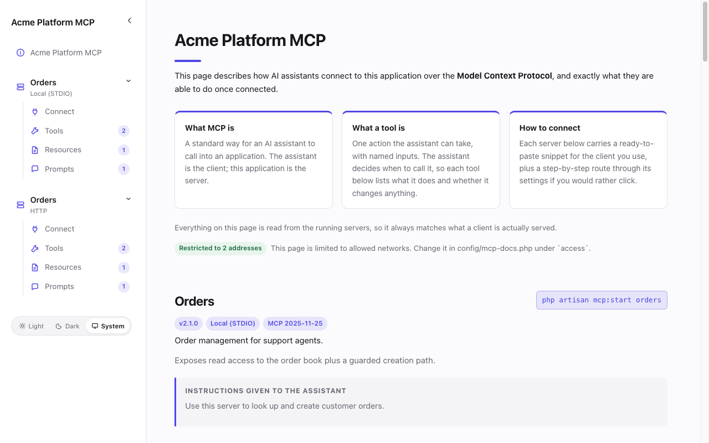

# Laravel MCP Docs

Generates a browsable documentation page for the [Laravel MCP](https://github.com/laravel/mcp)
servers your application registers: what tools they expose, what each one accepts,
and a ready-to-paste snippet for connecting every major MCP client.

The page is read from the running servers over the protocol itself — not parsed
out of your source code — so it cannot drift from what a client is actually served.



## Installation

```bash
composer require renatomaldonado/laravel-mcp-docs
```

The page is served at `/mcp/docs`. Publish the config to move it:

```bash
php artisan vendor:publish --tag=mcp-docs-config
```

Out of the box the page answers only `127.0.0.1` and `::1`; everyone else gets
a 403. To publish it, set `MCP_DOCS_ACCESS=public`, or list the addresses
allowed under `access.allowed_ips` — see "Public or restricted" below.

## What you get

Register servers the way Laravel MCP already expects, in `routes/ai.php`:

```php
use Laravel\Mcp\Facades\Mcp;

Mcp::local('orders', App\Mcp\Servers\OrdersServer::class);
Mcp::web('mcp/orders', App\Mcp\Servers\OrdersServer::class);
```

Both show up on the page, each with the install instructions for its own transport:
a `php artisan mcp:start` command for local servers, a URL for web ones.

Every client gets two routes to the same result — a config snippet to paste, and a
numbered walkthrough through that client's own settings for readers who would
rather click than edit a config file. Both follow the reader's operating system:
see "One walkthrough per operating system" below.

### Supported clients

| Client | Config | Location (macOS / Linux) | Location (Windows) |
|---|---|---|---|
| Claude Code | CLI (`claude mcp add`) | `~/.claude.json` or `.mcp.json` | `%USERPROFILE%\.claude.json` |
| Claude Desktop | JSON, or the Connectors UI for HTTP | `~/Library/Application Support/Claude/` | `%APPDATA%\Claude\` |
| ChatGPT | A developer-mode app, no file | — | — |
| OpenAI Codex | **TOML** | `~/.codex/config.toml` | `%USERPROFILE%\.codex\config.toml` |
| Cursor | JSON | `.cursor/mcp.json` | `.cursor\mcp.json` |
| VS Code | JSON (`servers` key) | `.vscode/mcp.json` | `.vscode\mcp.json` |
| Zed | JSON (`context_servers`) | `~/.config/zed/settings.json` | `%APPDATA%\Zed\settings.json` |
| Windsurf | JSON (`serverUrl` for HTTP) | `~/.codeium/windsurf/mcp_config.json` | `%USERPROFILE%\.codeium\...` |
| DeepSeek Harness | **YAML** plugin entry | `cordis.yml` | `cordis.yml` |

Two of these need a word of explanation:

- **ChatGPT and Codex are separate entries because they are separate
  mechanisms.** The Codex CLI, the ChatGPT desktop app and the IDE extension all
  read one `config.toml`, so a server added in any of them is added to all
  three — that is the `codex` entry. ChatGPT on the web reads nothing off your
  machine: a server reaches it as a developer-mode app registered against your
  account, which is the `chatgpt` entry. That route only exists for HTTP
  servers, and only for a URL that resolves on the public internet.
- **DeepSeek** has no MCP client in its consumer app; the official client is
  DeepSeek Harness via the `@deepseek-ai/dsh-mcp-client` plugin, which is what
  the `deepseek` entry covers.

## Two audiences, two descriptions

A tool's `#[Description]` is written for the model: short, cheap in tokens, and
the only thing the assistant sees. That rarely makes good human documentation.

This package reads the class docblock as the human-facing text, so you can write
for both without compromising either:

```php
/**
 * Creates an order from an existing cart.
 *
 * The cart must already carry a delivery address. Idempotent on
 * `idempotency_key`: replaying the same key returns the original order
 * instead of creating a duplicate.
 */
#[Description('Create an order from a cart.')]
#[IsIdempotent]
class CreateOrder extends Tool
{
    // ...
}
```

The page shows the docblock prose up front and tucks the model-facing description
behind a "What the assistant is told" disclosure. Backticks, `**bold**` and
`_italic_` in docblocks are rendered.

Tool annotations become badges a non-developer can read: `#[IsReadOnly]` shows as
**Read only**, `#[IsDestructive]` as **Destructive**, and so on.

### Text from config instead of docblocks

When your classes carry no docblock, or carry one not written for the public,
give the prose in config, keyed by class or by name. A class key wins over a name
key, and either wins over the docblock:

```php
'descriptions' => [
    'search-orders' => 'Find an order by customer, status or reference.',
    App\Mcp\Servers\OrdersServer::class => [
        'The order book, for support agents.',   // the summary
        'Every answer follows your own permissions.',
    ],
],
```

### Keeping the model-facing text private

Server instructions and tool and argument descriptions are prompt text. If they
should not be public, turn them off:

```php
'model_text' => env('MCP_DOCS_MODEL_TEXT', true),
```

With `false` they are removed at collection time, so they are absent from the
page, the JSON manifest and `mcp:docs:collect` alike. Names, types, enums,
defaults, badges and your configured descriptions still show. Anything other
than `true` hides it.

Arguments then lose their descriptions too. Give them public ones, keyed by
tool or prompt and by the name the inputs table shows:

```php
'arguments' => [
    'search-orders' => [
        'customer' => 'The customer, by name or e-mail.',
        'filters.city' => 'Town of the delivery address.',
        'items[].sku' => 'Product code of each line.',
    ],
],
```

## The manifest

The same data is available as JSON at `/mcp/docs.json`, and from the console:

```bash
php artisan mcp:docs:collect                       # human-readable summary
php artisan mcp:docs:collect --json                # canonical manifest
php artisan mcp:docs:collect --output=mcp.json     # write it to a file
php artisan mcp:docs:steps                         # walkthrough screenshot keys
php artisan mcp:docs:steps --os=windows            # ...for one platform
```

Committing that file per release gives you a diffable record of your server's
surface — which is how you catch a parameter that quietly became required.

## Configuration

```php
return [
    'route' => [
        'enabled' => env('MCP_DOCS_ENABLED', true),
        'uri' => env('MCP_DOCS_URI', 'mcp/docs'),
        'middleware' => ['web'],
        'name' => 'mcp-docs',
    ],

    // See "Public or restricted" below. Closed by default.
    'access' => [
        'mode' => env('MCP_DOCS_ACCESS', 'restricted'),
        'allowed_ips' => ['127.0.0.1', '::1'],
    ],

    'branding' => [ /* see "Branding" below */ ],

    'theme' => [
        'default' => env('MCP_DOCS_THEME', 'system'),
        'switcher' => true,
    ],

    // Only needed if a server is not discovered automatically.
    'servers' => [
        // 'mcp/orders' => App\Mcp\Servers\OrdersServer::class,
    ],

    'only' => [],   // keys or class names to document exclusively
    'except' => [], // keys or class names to leave out

    'clients' => [
        'claude-code', 'claude-desktop', 'chatgpt', 'codex',
        'cursor', 'vscode', 'zed', 'windsurf', 'deepseek',
    ],

    // Your own screenshots for the walkthrough steps.
    'screenshots' => [],
];
```

## Branding

The page carries your identity, not the package's:

```php
'branding' => [
    'name' => 'Acme Developer Platform',
    'tagline' => 'Internal tools for agents',

    // A URL, a path under public/, a data URI, or an absolute path to an SVG
    // on disk. An SVG is inlined, so `currentColor` follows the theme.
    'logo' => public_path('img/acme.svg'),
    'logo_dark' => null,      // only when your mark needs different treatment
    'favicon' => '/favicon.ico',

    'accent' => '#e2571f',    // recolours links, active tabs and callouts
    'accent_dark' => '#ff9668',

    'links' => ['Support' => 'https://acme.test/support'],
    'footer' => 'Questions? Ask in `#platform`.',
],
```

Set `logo_dark` only when you genuinely need a second mark — with one logo the
page keeps it visible on both backgrounds rather than hiding it on dark.

Accent values are validated before being inlined; anything that is not a colour
is dropped rather than written into the page.

## The introduction

The page opens with an explanation of MCP for readers meeting it for the first
time. Every part of it is replaceable, because the version worth reading usually
talks about *your* servers rather than the protocol in the abstract:

```php
'intro' => [
    'enabled' => true,

    'heading' => 'Order tools for support agents',
    'lede' => 'What our assistant can do with the order book, and how to connect it.',

    // A string or a list of paragraphs, rendered under the lede. This is the
    // place to describe the servers being documented.
    'overview' => [
        'These servers give agents read access to the order book, plus a guarded
         path for creating orders on a customer\'s behalf.',
        'Access is scoped to your own account: an assistant can only reach what
         you can reach in the app itself.',
    ],

    // Replaces the three explainer cards. An empty array removes them.
    'cards' => [
        ['title' => 'Who this is for', 'body' => 'Support agents using an AI assistant.'],
        ['title' => 'What it can do', 'body' => 'Look up orders and create them from a cart.'],
    ],

    // false keeps the default line; a string replaces it; null removes it.
    'footnote' => false,
],
```

Backticks, `**bold**` and `_italic_` render throughout. Set `enabled` to false to
drop the section entirely and open straight onto the servers.

## Light, dark and system

The page ships all three. Readers get `system` by default, follow their OS from
there, and can override it with the switcher in the sidebar. The choice is stored
per browser and applied before first paint, so there is no flash of the wrong theme.

```php
'theme' => [
    'default' => env('MCP_DOCS_THEME', 'system'), // 'light' | 'dark' | 'system'
    'switcher' => true,
],
```

Setting `switcher` to false locks the page to `default` and ignores any choice a
reader stored earlier.

## One walkthrough per operating system

A menu path, a keyboard shortcut and a config file location are three of the
things most likely to be wrong in an install guide, and all three move between
platforms. So the page does not write one walkthrough and hope: each client is
asked for its instructions on macOS, Windows and Linux separately.

Platforms whose answer comes back identical are merged into a single tab, so a
selector only appears where something genuinely differs — Codex reads the same
on macOS and Linux and gets one "macOS & Linux" tab, while Claude Desktop gets
three. The reader picks a system once and every walkthrough on the page follows,
with the choice stored per browser. Their own system is preselected.

Where a client has no route at all, the page says so instead of leaving a gap.
Claude Desktop has no Linux build, so a local STDIO server there is a dead end —
and the page says that, then points at Claude Code and at `Mcp::web()`. A remote
server on Linux is not a dead end, because custom connectors belong to the
account rather than to the app, so that walkthrough sends the reader to
claude.ai in a browser instead.

The test suite enforces the part that can be enforced: every client answers for
every platform exactly once, and no walkthrough shows a reader a path or
shortcut belonging to a different one — no `%APPDATA%` on macOS, no `~/` or
`Cmd` on Windows.

## A video per client

A screen recording of the whole flow can sit above a client's instructions:

```php
'videos' => [
    'claude-desktop' => [
        'src' => '/videos/claude-desktop.mp4',
        'poster' => '/videos/claude-desktop.jpg',
        'caption' => 'Connecting from Claude Desktop',
    ],
],
```

Use H.264 MP4: a `.mov` from a screen recorder plays in Safari but not
everywhere else.

## When a client's instructions go out of date

Client interfaces change without notice. Replace a client's snippet or steps
from config, without waiting for a release:

```php
'walkthroughs' => [
    'claude-desktop' => [
        'steps' => [
            'open-settings' => ['title' => 'Open **Settings**', 'body' => 'Click your name, then Settings.'],
            'add-custom' => ['title' => 'Add a custom connector', 'body' => 'Paste `{url}` and save.'],
        ],
    ],

    'zed' => [
        'snippet' => ['language' => 'json', 'code' => '{"context_servers": {"{name}": {"url": "{url}"}}}'],
    ],
],
```

`snippet` and `steps` each replace the client's own; nest either under `macos`,
`windows` or `linux` to change one platform only. Steps are keyed by their
screenshot key, so `mcp:docs:steps` lists the keys to copy and screenshots
keep attaching. Text may use `{url}`, `{name}`, `{key}` and `{command}`. A
walkthrough you replaced no longer says when the package last checked it.

For a client that needs logic rather than text, extend it instead — see
"Adding a client" below.

## Screenshots in the walkthroughs

Each walkthrough step has a key you can hang your own screenshot on. The package
deliberately ships none: it cannot redistribute screenshots of Claude Desktop,
Cursor or VS Code, and any it did ship would be stale within a release or two.
Steps render as text until you supply an image.

List the available keys:

```bash
php artisan mcp:docs:steps
php artisan mcp:docs:steps --client=cursor
php artisan mcp:docs:steps --os=windows
```

A client whose walkthrough differs by platform reports platform-scoped keys, so
each tab can carry the screenshot that actually matches what the reader sees.

Then attach images:

```php
'screenshots' => [
    'cursor' => [
        'create-file' => '/img/mcp/cursor-create-file.png',
        'customize' => [
            'src' => '/img/mcp/cursor-customize.png',
            'caption' => 'The Customize page in Cursor',
        ],
    ],

    'claude-desktop' => [
        // Nest under a platform where the screen itself differs. An
        // OS-specific image wins over one attached to the bare step key.
        'macos' => ['open-settings' => '/img/mcp/claude-settings-macos.png'],
        'windows' => ['open-settings' => '/img/mcp/claude-settings-windows.png'],
    ],
],
```

## How the walkthroughs are kept honest

Client interfaces move without notice, so the walkthroughs are not written from
memory and are not presented as permanently current. Instead:

- Every step was checked against that client's **official documentation**, and the
  date of that check ships in `Client::VERIFIED_ON`.
- Every walkthrough renders a footer linking to the page it was checked against,
  so a reader who finds a step out of date has the authority one click away.
- The test suite enforces the structural parts that *can* be guaranteed: every
  client answers for every operating system exactly once, either with steps or
  with a stated reason there is no route; keys are unique and slug-shaped; no
  step is missing a body; every walkthrough ends by telling the reader how to
  verify the connection; the config file named in the prose matches the one in
  the snippet; and no platform is shown another platform's paths or shortcuts.
- A handful of URLs that have already moved are pinned against in the tests, so
  a citation cannot quietly go stale back to a page that now redirects.

If a client changes, correct its class and move `VERIFIED_ON` — or publish the
views and edit the walkthrough in your own application. `VERIFIED_ON` is a claim
about work that was done, not a timestamp to bump: move it when you have
actually re-read the linked pages.

## Public or restricted

This page enumerates everything an AI assistant can do to your application, so
the package treats it as internal until you say otherwise:

```php
'access' => [
    // 'public'     - anyone who can reach the URL can read it
    // 'restricted' - only "allowed_ips" can; everyone else gets a 403
    'mode' => env('MCP_DOCS_ACCESS', 'restricted'),

    'allowed_ips' => [
        '127.0.0.1',
        '::1',
        // '10.0.0.0/8',
        // '2001:db8::/32',
    ],
],
```

`allowed_ips` takes single addresses and CIDR ranges, IPv4 and IPv6. Both the
page and the JSON manifest are covered.

The default is deliberately closed, and it fails closed in every direction:

- Anything other than the exact string `"public"` is treated as restricted, so a
  typo or a truthy value locks the page rather than opening it.
- `restricted` with an empty `allowed_ips` allows nobody, not everybody.
- The check is appended to the route middleware by the service provider, so
  emptying `mcp-docs.route.middleware` cannot remove it.

Whichever mode is active is shown at the top of the page itself, so the setting
is visible instead of buried in a config file.

**Behind a proxy or CDN**, configure Laravel's `TrustProxies` first. Without it
every request appears to come from the load balancer, and an IP allowlist either
admits everyone or no one.

For an extra gate, combine it with auth in the usual way:

```php
'middleware' => ['web', 'auth', 'can:view-mcp-docs'],
```

Or keep the page out of an environment entirely:

```php
'route' => ['enabled' => app()->environment('local', 'staging')],
```

### Authenticated manifests

By default the page lists everything a server registers. To document the manifest
as a specific user would be served it — after your own gates have run — resolve
the collector yourself:

```php
use LaravelMcpDocs\Collector\ServerCollector;

$document = app(ServerCollector::class)->actingAs($user)->collect();
```

### Adding a client

Client config formats change faster than this package will. Add or replace one
without waiting for a release:

```php
use LaravelMcpDocs\Collector\ServerDocument;
use LaravelMcpDocs\Install\Client;
use LaravelMcpDocs\Install\ClientRegistry;
use LaravelMcpDocs\Install\InstallStep;
use LaravelMcpDocs\Install\Snippet;

class Continue_ extends Client
{
    public function key(): string
    {
        return 'continue';
    }

    public function label(): string
    {
        return 'Continue';
    }

    public function snippet(ServerDocument $server): Snippet
    {
        return Snippet::json(
            ['mcpServers' => [$server->registration->key => ['url' => $server->registration->url]]],
            path: '.continue/config.json',
        );
    }

    /** Optional: the point-and-click route. Omit it and only the snippet shows. */
    public function steps(ServerDocument $server): array
    {
        return [
            new InstallStep('open-config', 'Open the assistant config', 'Use **Continue → Configure**.'),
            new InstallStep('paste', 'Paste the configuration', 'Merge it into `mcpServers` and save.'),
        ];
    }
}
```

Register it in a service provider, then list its key in `mcp-docs.clients`:

```php
$this->app->make(ClientRegistry::class)->register('continue', Continue_::class);
```

`snippet()` and `steps()` are the answer for every platform. Where a client
differs, override the per-platform pair instead — anything you do not override
falls back to them, so a client only pays for the variation it actually has:

```php
use LaravelMcpDocs\Install\OperatingSystem;

/** Only the platforms this client has a build for. */
public function platforms(): array
{
    return [OperatingSystem::MacOs, OperatingSystem::Windows];
}

public function snippetOn(ServerDocument $server, OperatingSystem $os): Snippet
{
    return Snippet::json($config, path: $os->home('~/.continue/config.json'));
}

public function stepsOn(ServerDocument $server, OperatingSystem $os): array
{
    return [
        new InstallStep('open-config', 'Open the assistant config', $os->isWindows()
            ? 'Use **File → Preferences → Continue**.'
            : 'Use **Continue → Configure** in the menu bar.'),
        // ...
    ];
}

/** Say why, rather than leaving a reader on this platform with a blank tab. */
public function unavailableOn(ServerDocument $server, OperatingSystem $os): ?string
{
    return $server->registration->isHttp() ? null : 'Continue cannot start a local server.';
}
```

`OperatingSystem::home()` rewrites a home-relative path for the platform —
`~/.continue/config.json` becomes `%USERPROFILE%\.continue\config.json` on
Windows. Only use it for paths that really are a straight translation; anything
that moves to a different directory (as Zed's settings do) has to be named per
platform by hand.

The page groups platforms whose output comes back identical, so returning the
same thing for macOS and Linux produces one tab rather than two.

### Customising the page

```bash
php artisan vendor:publish --tag=mcp-docs-views
```

The sidebar collapses to a 62px icon rail rather than disappearing, so every
destination stays one click away; each server group collapses independently, and
both states persist per browser.

Views land in `resources/views/vendor/mcp-docs`. Styles are inlined from
`resources/assets/docs.css` in the package so the page works offline in a single
request. Palette tokens are plain custom properties defined for light, system-dark
and forced-dark, so overriding a colour means redefining the token in all three —
or just setting `branding.accent`, which does it for you.

## How discovery works

Laravel MCP's registrar stores servers as closures and routes rather than class
names, so this package recovers each class from the variable its closure captured.
If a future release changes that, discovery degrades to skipping the server rather
than guessing — name it in `mcp-docs.servers` to pin it explicitly.

Under `php artisan route:cache` the routes file that calls `Mcp::web()` never
runs, so the registrar is empty. Servers named in `mcp-docs.servers` are still
documented: a key matching a registered route as HTTP, any other as local.
Production apps that cache routes should name their servers there.

When clients reach a web server through a gateway or proxy on another path,
name the URL they connect to; the install snippets use it instead of the
route's own:

```php
'urls' => ['mcp/orders' => 'https://example.com/mcp'],
```

## Testing

```bash
composer test
```

To look at the page while working on it, `composer serve` opens it on a demo
server registered in `workbench/routes/web.php`.

## License

MIT.
